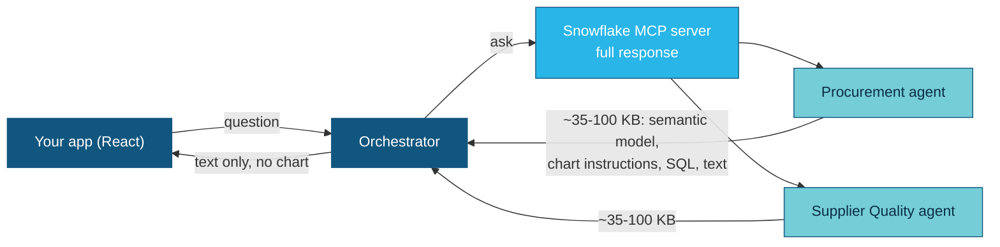
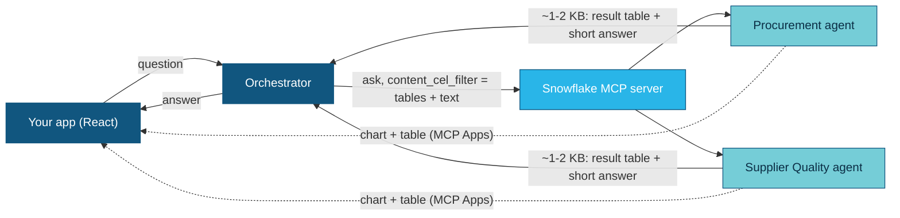
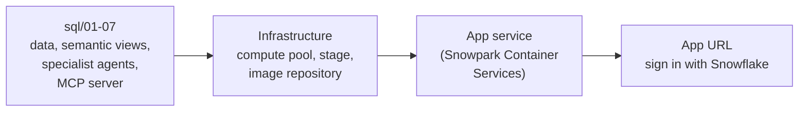

# Multi-Agent with Cortex Agents: Before vs After

A playbook for teams that built a multi-agent setup on Cortex Agents before the latest Snowflake-managed MCP
updates. It shows **what changed in MCP**, **exactly what you need to change** in your own setup, and **how to
measure the difference yourself**: accuracy, cost, latency and how much context reaches the orchestrator.

A front-end app asks one **orchestrator**, which calls independent **specialist agents** (one per business
domain) through the managed MCP server. The app runs the old way and the new way side by side on the same
question.


**In this test, the new way cost 47–74% less, kept 100% accuracy and put the specialists' charts back in the
app.** [Results](#results)

| If you want to… | Go to |
|---|---|
| Understand what changed and why it saves tokens | [The old way](#1-the-old-way-and-what-went-wrong) · [What changed in MCP](#2-what-changed-in-mcp) |
| See exactly what to change in your setup | [What you need to change](#3-what-you-need-to-change) |
| Check where every number comes from, and reproduce it | [Where every number comes from](#5-where-every-number-comes-from) |
| See how the demo was built, step by step | [How it was built](#6-how-it-was-built) |
| Run it | [Set it up](#7-set-it-up-one-command) · [Show it](#8-show-it) |
| Use it for your own agents | [Use it as a framework](#9-use-it-as-a-framework) |

---

## Why multi-agent

Each domain (here: procurement, supplier quality, inventory, customer orders) is owned by a different team with
its own semantic views. Giving each team its own agent keeps that ownership clear and each agent focused.
Users still get **one place to ask**: an orchestrator picks the specialists a question needs, combines their
answers, and the app shows a chart.

## 1. The old way and what went wrong



Teams usually built this one of two ways. Each had a different problem:

| | MCP server, full response | Stored procedure + `DATA_AGENT_RUN` |
|---|---|---|
| How the orchestrator calls a specialist | Through the managed MCP server | A custom tool runs a stored procedure that calls the specialist and returns its text |
| Context sent back to the orchestrator | **Too much**: the whole agent run, including the semantic-view context, chart instructions and SQL (~35–100 KB per call) | **Little**: just the written answer |
| Tables and charts in the app | No | **Lost**: the procedure keeps only the text |
| What drives the cost | Reading the bloated responses on every call, and again on every later turn | **Re-asking**: with only prose to go on, the orchestrator often calls specialists again |

The stored-procedure approach was a reasonable fix for the bloat: less context comes in. But with only prose
coming back, the orchestrator lacks the context to route well. It re-asks a specialist for "the exact
numbers", or passes the next specialist an incomplete question, and every extra call is a full agent run. It
also can't return a table or chart to the app. In this test it averaged **2.3 specialist calls per question,
versus 1.3** for the MCP patterns.

## 2. What changed in MCP



| New MCP capability | What it does | Why it saves tokens |
|---|---|---|
| **Response filtering** (`content_cel_filter`) | You choose which parts of a specialist's run come back: `full`, `compact` (now the default), `outline`, or your own CEL expression | The orchestrator reads ~1–2 KB instead of ~35–100 KB per call, and that smaller context is carried into every later step |
| **MCP Apps** (preview, account flag) | The specialist's finished chart (Vega-Lite) and table come back in a separate field, `structuredContent._mcp_app`, whatever the filter | Charts reach the app without passing through the orchestrator's context, so you don't need a second call to redraw them |
| **`AGENT_RUN_RESULT`** | Fetch other parts of a finished run later, by run ID | You pay for detail (SQL, reasoning) only when you need it |
| **Background runs** (`background: true` + `ASYNC_AGENT_RUN_STATUS`) | Long questions run asynchronously | No client timeouts on long runs |

## 3. What you need to change

Most of your setup stays as it is. These are the only differences between the two sides of this demo.

### a. Specialist agents: no change (make sure each has `data_to_chart`)

```yaml
# sql/03_specialist_agents.sql (same for before and after)
tools:
  - tool_spec:
      type: cortex_analyst_text_to_sql
      name: query_procurement
  - tool_spec:
      type: data_to_chart          # needed for the MCP Apps charts
      name: data_to_chart
```

### b. MCP server: one `CORTEX_AGENT_RUN` tool per specialist (replaces the stored-procedure wrappers)

```diff
- -- Before: one stored procedure per specialist, called by the orchestrator as a custom tool
- CREATE PROCEDURE ASK_PROCUREMENT_AGENT(QUESTION STRING) ...   -- DATA_AGENT_RUN, returns text only
+ -- After: the specialists are tools on one managed MCP server (sql/05_mcp_server.sql)
+ CREATE MCP SERVER SPECIALIST_AGENTS_MCP FROM SPECIFICATION $$
+ tools:
+   - name: "procurement_agent"
+     type: "CORTEX_AGENT_RUN"
+     identifier: "MULTIAGENT_DEMO.DEMO.PROCUREMENT_AGENT"
+     description: "Purchase orders, spend, units and prices by supplier, part, commodity, plant and date."
+ $$;
```

The `description` is what the orchestrator routes on, so write it like you'd explain the domain to a new analyst.

### c. The orchestrator's MCP call: one argument

This is the whole difference between "MCP full response" and the new way:

```diff
  {
    "jsonrpc": "2.0", "id": 1, "method": "tools/call",
    "params": {
      "name": "procurement_agent",
      "arguments": {
        "text": "Which 5 suppliers have the highest total purchase spend?",
-       "content_cel_filter": "full"
+       "content_cel_filter": "content.filter(c, c.type == 'table' || c.type == 'text')"
      }
    }
  }
```

In this repo that's one line in `app/server.py`:

```python
FILTERS = {"before": "full", "after": "content.filter(c, c.type == 'table' || c.type == 'text')"}
```

**Why tables + text, and not charts:**

| Filter | Result in our testing |
|---|---|
| Tables only | Single-number answers ("Guadalajara has 108") come back as text with no table, so they were dropped. The two-specialist question that needed them fell to 0% correct |
| **Tables + text** | Everything the orchestrator needs to route and answer, in ~1–2 KB. 100% correct |
| Also include charts | Puts the Vega-Lite spec back into the orchestrator's context, which it never reads. Not needed: MCP Apps delivers charts in `structuredContent._mcp_app` whatever the filter |

The filter decides what the **orchestrator** reads. MCP Apps decides what the **app** draws. Keep them separate.

### d. The app: draw the charts from `_mcp_app`

```diff
  result = mcp_call(agent, {...})
  answer_context = result["content"][0]["text"]                 # goes to the orchestrator (now ~1-2 KB)
+ blocks = result["structuredContent"]["_mcp_app"]["blocks"]     # goes straight to the browser
+ # blocks = [{"type": "table", "columns": [...], "rows": [...]},
+ #           {"type": "chart", "spec": {...Vega-Lite...}}]
```

```js
// app/index.html: render each chart block with vega-embed
vegaEmbed(element, block.spec, { actions: false });
```

### Checklist

- [ ] Each specialist agent has `data_to_chart`
- [ ] One managed MCP server with a `CORTEX_AGENT_RUN` tool per specialist, each with a clear `description`
- [ ] The orchestrator passes `content_cel_filter` (tables + text, or `compact`). Never `full`
- [ ] MCP Apps enabled on the account (preview; ask your Snowflake account team)
- [ ] The app renders `structuredContent._mcp_app.blocks` (Vega-Lite + table rows)
- [ ] Retire the `DATA_AGENT_RUN` stored-procedure wrappers

## 4. Results

The same 6 questions (4 need one specialist, 2 need two), the same data and the same model (Claude Sonnet),
with 18 runs per pattern:

| | Before: stored procedure | Before: MCP full response | **After: MCP filtered + MCP Apps** |
|---|---|---|---|
| **Accuracy**: correct answers | 78% | 100% | **100%** |
| **Cost**: credits per question | 0.259 | 0.128 | **0.068** |
| **Cost**: credits per 1,000 questions | 259 | 128 | **68** |
| **Latency**: median | 69 s | 16 s | **16 s** |
| Specialist calls per question | 2.3 (re-asking) | 1.3 | **1.3** |
| Context sent back to the orchestrator | text only | ~54 KB | **~1.9 KB** |
| Orchestrator tokens | 127K | 23K | **1.3K** |
| Chart in the app | 83%, redrawn by the orchestrator after re-asking | no | **94%, the specialist's own chart** |

- **vs MCP full response** (the same orchestrator and specialists, with only the filter changed): **47% lower
  cost**, the same accuracy and speed, 94% fewer orchestrator tokens, and charts in the app.
- **vs stored procedures:** **74% lower cost**, 77% faster, and accuracy up from 78% to 100%. Less context
  comes in per call, but re-asking costs more. Also, the stored-procedure orchestrator is a full Cortex Agent
  while the MCP orchestrator is a small router, so part of this gap is the orchestrator itself.
- Answers that are a single number come back as text with no chart to draw, which is why charts appear on 94%
  rather than 100% of answers.
- Cost falls more than the token count does because cached tokens bill at a lower rate. The orchestrator's
  own tokens are the full-price kind. Most of what's left is each specialist doing its actual work.

Raw data: [`benchmark/results.csv`](benchmark/results.csv), one row per run, including each answer.

## 5. Where every number comes from

Every metric here comes from something you can pull yourself. Nothing is estimated from outside Snowflake.

| Metric | Source | In this repo |
|---|---|---|
| **Context sent back** to the orchestrator | Size of the MCP tool result, `result.content[0].text` (bytes). This is what lands in the orchestrator's context window | `kb_to_orchestrator` in `app/server.py` → `run()` |
| **Specialist tokens** | The specialist's run metadata in the same result: `metadata.usage.tokens_consumed[]` → `input_tokens.total`, `input_tokens.cache_read`, `output_tokens.total` | `specialist_usage()` in `app/server.py` |
| **Orchestrator tokens** | `usage.prompt_tokens` + `usage.completion_tokens` on each `/api/v2/cortex/inference:complete` call (route, follow-up, answer) | `complete()` in `app/server.py` |
| **Credits** (estimated live) | Tokens × the billed per-token rates for the model. Cached input is about 12× cheaper than full-price input | `RATES` in `app/server.py` |
| **Credits** (billed) | `SNOWFLAKE.ACCOUNT_USAGE.CORTEX_AGENT_USAGE_HISTORY.TOKEN_CREDITS`, matched on each specialist run's `thread_id`. Lags up to about an hour | Query 3 in [`metrics.sql`](metrics.sql) |
| **Latency** | Wall-clock time around the whole question, from routing to the final answer | `seconds` in `run()` |
| **Specialist calls** | Number of MCP `tools/call` requests per question | `specialist_calls` in `run()` |
| **Charts** | Whether `structuredContent._mcp_app.blocks` contains a `chart` block | `charts` in `run()` |
| **Stored-procedure pattern usage** | The procedure logs each `DATA_AGENT_RUN` response's `metadata.usage` to `SPECIALIST_USAGE_LOG` | `sql/04_before_stored_procedures.sql`, read by `benchmark/measure.py` |
| **Accuracy** | The answer contains the true value from `benchmark/questions.json` (computed with SQL directly on the tables) | `is_correct()` in `benchmark/measure.py` |

### Try it on one call (2 minutes)

[`compare_call.py`](compare_call.py) makes the same specialist call twice, once with `full` and once with the
new filter, and prints each metric with its source. It's about 90 lines, and you only need `requests`:

```bash
export SNOWFLAKE_ACCOUNT=<org>-<account> SNOWFLAKE_PAT=<token>
python3 compare_call.py supplier_quality_agent "Which 5 suppliers have the worst defect rate in PPM?"
```

```
                               before (full)   after (tables + text)
context sent back                    34.9 KB                  1.5 KB
~orchestrator tokens                   8,934                     384
specialist tokens                     78,053                  77,979
specialist credits                    0.0736                  0.0480
latency                               13.7 s                  14.5 s
chart for the app                        yes                     yes
```

The specialist does the same work either way. What changes is how much of it comes back for the orchestrator
to read, on this call and on every later step of the conversation.

### Or with curl

```bash
curl -s -X POST "https://<account>.snowflakecomputing.com/api/v2/databases/MULTIAGENT_DEMO/schemas/DEMO/mcp-servers/SPECIALIST_AGENTS_MCP" \
  -H "Authorization: Bearer $SNOWFLAKE_PAT" \
  -H "X-Snowflake-Authorization-Token-Type: PROGRAMMATIC_ACCESS_TOKEN" \
  -H "Content-Type: application/json" \
  -d '{"jsonrpc":"2.0","id":1,"method":"tools/call","params":{"name":"supplier_quality_agent",
       "arguments":{"text":"Which 5 suppliers have the worst defect rate in PPM?","content_cel_filter":"full"}}}' \
  -o full.json
# Repeat with "content_cel_filter":"content.filter(c, c.type == '\''table'\'' || c.type == '\''text'\'')" -o filtered.json

jq -r '.result.content[0].text' full.json | wc -c                                       # context sent back
jq -r '.result.content[0].text | fromjson | .metadata.usage.tokens_consumed' full.json  # tokens
jq '.result.structuredContent._mcp_app.blocks[].type' filtered.json                     # MCP Apps blocks
```

### Billed credits from ACCOUNT_USAGE

```sql
-- What Snowflake actually billed for specialist runs, per day and agent
SELECT DATE_TRUNC('day', start_time) AS day, agent_name,
       COUNT(*) AS runs, SUM(token_credits) AS credits, SUM(token_credits) / COUNT(*) AS credits_per_run
FROM SNOWFLAKE.ACCOUNT_USAGE.CORTEX_AGENT_USAGE_HISTORY
WHERE agent_database_name = 'MULTIAGENT_DEMO'
GROUP BY 1, 2 ORDER BY 1 DESC, 2;
```

`metrics.sql` has the full set: before vs after by mode, % change, billed credits matched to each app run,
and recent runs.

## 6. How it was built

Each step is one file, with a short explanation at the top of what it creates and why. Run them in order in a
Snowsight worksheet (replace `COMPUTE_WH` with your warehouse), or let `deploy.sh` run them for you.

| Step | File | What it creates | Notes |
|---|---|---|---|
| 1 | `sql/01_sample_data.sql` | Shared dimensions (plants, suppliers, parts) and one fact table per domain | Synthetic and deterministic, so the true answers never change |
| 2 | `sql/02_semantic_views.sql` | One semantic view per domain, with synonyms, business rules and verified queries | These are the YAMLs that bloated the full response |
| 3 | `sql/03_specialist_agents.sql` | Four specialist agents: Analyst + `data_to_chart` | The same for every pattern |
| 4 | `sql/04_before_stored_procedures.sql` | **Before, stored procedure:** `ASK_SPECIALIST` (calls `DATA_AGENT_RUN`, keeps the text, logs usage), one wrapper per specialist, and the `ORCHESTRATOR_SPROC` agent | The pattern being retired |
| 5 | `sql/05_mcp_server.sql` | The managed MCP server, one `CORTEX_AGENT_RUN` tool per specialist | Used by **both** MCP patterns; only the filter differs |
| 6 | `sql/06_demo_runs.sql` | `DEMO_RUNS`, the log behind the app's scoreboard and `metrics.sql` | |
| 7 | `sql/07_appendix_toolset.sql` | Optional `agent_toolset` orchestrator | See the [appendix](#appendix-agent-toolsets) |
| 8 | `app/server.py` + `app/index.html` | The orchestrator and the React app, hosted in Snowpark Container Services | `app/spcs_infra.sql`, `app/spcs_service.sql` |

### The orchestrator (`app/server.py`)

One function, `run(mode, question)`, does the whole flow. `mode` is `before` or `after`, and the only thing it
changes is the filter:

1. **Route.** Read the specialists from the MCP server's `tools/list` (`specialists()`). One LLM call (the
   `ROUTER` prompt) picks the ones the question needs and drafts a question for each.
2. **Ask the specialists in order.** For two-domain questions, the second question is rewritten using the
   first specialist's results (the `FOLLOW_UP` prompt), e.g. "for these 5 supplier IDs, what is the defect rate?"
3. **Collect what came back.** The specialist's text or table goes into the orchestrator's context. In
   `after` mode, the chart and table blocks from `structuredContent._mcp_app` go to the browser untouched.
4. **Answer.** One more LLM call writes a 2–4 sentence answer.
5. **Measure and log.** Tokens, credits, size, latency and charts are computed as in
   [section 5](#5-where-every-number-comes-from) and written to `DEMO_RUNS`.

Authentication is in `headers()`. Inside Snowflake the app uses the service's own OAuth token (from
`/snowflake/session/token`), so there are no credentials in the container. On a laptop it uses your PAT.

### The app (`app/index.html`)

A single-page React app (no build step) with a scoreboard and two panels. React, Vega-Lite and the markdown
renderer are bundled in `app/vendor/`, because Snowflake's app gateway only allows scripts served by the app
itself.

## 7. Set it up (one command)

**You need:**
- A Snowflake account with Cortex Agents and Claude Sonnet
- A warehouse
- A role that can create databases, agents, compute pools and integrations (ACCOUNTADMIN works)
- A [programmatic access token](https://docs.snowflake.com/en/user-guide/programmatic-access-tokens) for your user
- The [Snowflake CLI](https://docs.snowflake.com/en/developer-guide/snowflake-cli/installation/installation)
  and `crane` (`brew install crane`) or Docker
- **MCP Apps** enabled on the account for the charts (preview; ask your Snowflake account team)

```bash
export SNOWFLAKE_ACCOUNT=<org>-<account>  SNOWFLAKE_USER=<user>  SNOWFLAKE_PAT=<token>
./deploy.sh <warehouse>
```

It takes about a minute (2–4 the first time) and prints the app URL. Open it and sign in with your Snowflake
user.



Everything is created in `MULTIAGENT_DEMO.DEMO`. Running `deploy.sh` again updates it in place, with the same
URL.

## 8. Show it

1. Click a sample question. **Before** (MCP full response) and **After** (filtered + MCP Apps) run the same
   question at the same time.
2. Compare the stat tiles: KB sent to the orchestrator, orchestrator tokens, credits and seconds. Before shows
   **No chart**; After shows the specialists' own charts.
3. Expand **"What the orchestrator received"** on each side to see the actual payload.
4. The **Running comparison** at the top averages every question asked so far.
5. Pull the same numbers in Snowsight with [`metrics.sql`](metrics.sql). Reset the scoreboard before a session
   with `TRUNCATE TABLE MULTIAGENT_DEMO.DEMO.DEMO_RUNS;`.

To rerun the full benchmark, including the stored-procedure pattern:
`python3 benchmark/measure.py --pattern all --reps 3`.

## 9. Use it as a framework

Nothing in the code is specific to the four example specialists:

| Piece | Where | What you'd change for your own use |
|---|---|---|
| Specialist agents | `sql/03_specialist_agents.sql` | Your own agents, each with its semantic view, Analyst tool and `data_to_chart` |
| Which specialists exist | `sql/05_mcp_server.sql` | One `CORTEX_AGENT_RUN` tool per specialist. **The description is what the orchestrator routes on** |
| Orchestrator | `app/server.py` → `run()` | Usually nothing. It reads the specialists from the MCP server at run time |
| What comes back | `FILTERS` in `app/server.py` | The CEL expression that decides what the orchestrator sees |
| Front end | `app/index.html` | Your own React app: render `_mcp_app` blocks with Vega-Lite |

### Add your own specialist (no Python changes)

1. Create a semantic view and an agent for the new domain: copy one of the agents in
   `sql/03_specialist_agents.sql` and point it at your semantic view.
2. Add a tool for it to the MCP server in `sql/05_mcp_server.sql`:

   ```yaml
     - name: "warranty_agent"
       type: "CORTEX_AGENT_RUN"
       identifier: "MY_DB.MY_SCHEMA.WARRANTY_AGENT"
       title: "Warranty"
       description: "Warranty claims, claim cost and failure rates by part, customer and date."
   ```
3. Re-run that file (or `./deploy.sh`). Within 5 minutes the orchestrator picks the new specialist up from
   the MCP server's tool list and starts routing questions to it.

## What's in the repo

```
README.md            this playbook
deploy.sh            one-command setup in Snowflake (prints the app URL)
compare_call.py      one specialist call, before vs after, with every metric and its source
metrics.sql          before/after cost and latency, including billed credits
sql/01-07            data, semantic views, specialist agents, both patterns, MCP server, run log
app/                 the orchestrator (server.py), the React app (index.html) and its hosting
benchmark/           the full benchmark: script, questions with true answers, our results
```

## Appendix: agent toolsets

If Snowflake Intelligence is the front end, the orchestrator can also borrow the specialists' tools with
`agent_toolset`. It has native charts and cost 0.070 credits / 14 s per question in this test. It works well
with a handful of specialists. With many, every borrowed tool is listed on each step and cost grows. For your
own app, use the MCP approach above.

## Notes

- The data is synthetic. Your numbers will vary with your semantic views, questions and models; use
  `compare_call.py` and `metrics.sql` to measure your own.
- MCP Apps is a preview feature. Without it, response filtering still works and your app can chart the
  returned table itself.
- When you're done, suspend the service and pool:
  `ALTER SERVICE MULTIAGENT_DEMO.DEMO.BEFORE_AFTER_APP SUSPEND; ALTER COMPUTE POOL MULTIAGENT_DEMO_POOL SUSPEND;`
