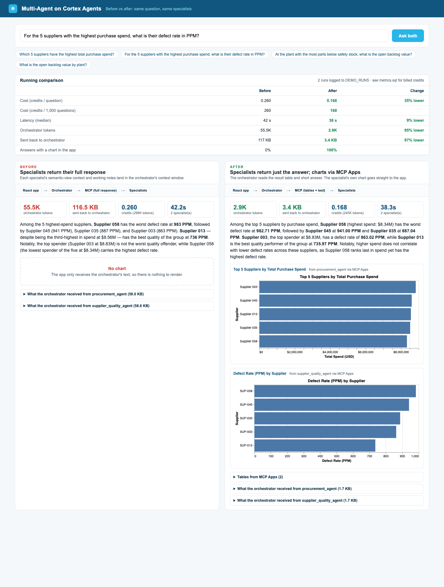
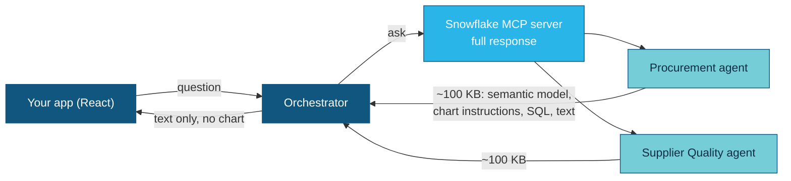
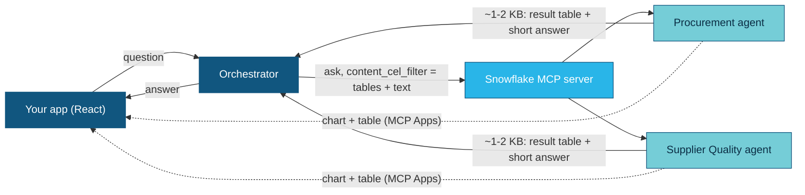
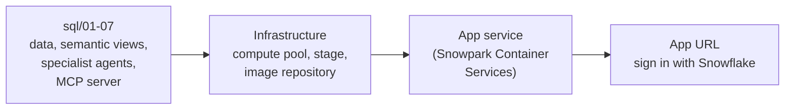

# Multi-Agent with Cortex Agents: Before vs After

A front-end app asks one **orchestrator**, which calls **specialist agents** (one per business domain)
through the Snowflake-managed MCP server. This demo shows what changed in that flow, and measures the
difference in **accuracy, cost and latency** live, side by side.



**Quick links:** [Set it up](#set-it-up-one-command) · [Show it](#show-it) ·
[Pull the metrics](#pull-the-metrics) · [Results](#results) · [Demo script](DEMO_SCRIPT.md) ·
[Slides](docs/Multi-Agent_on_Cortex_Agents.pptx)

---

## Why multi-agent

Each domain (procurement, supplier quality, inventory, customer orders) is owned by a different team with
its own semantic views. Giving each team its own agent keeps that ownership clear. Users still get **one
place to ask**: an orchestrator picks the specialists a question needs, combines their answers, and the app
shows a chart.

## Before: what went wrong



Teams usually built this one of two ways, and each had a different problem:

| | MCP server, full response | Stored procedure + `DATA_AGENT_RUN` |
|---|---|---|
| How the orchestrator calls a specialist | Through the managed MCP server | A custom tool runs a stored procedure that calls the specialist and returns its text |
| Context sent back to the orchestrator | **Too much**: the specialist's semantic-view context, chart instructions and SQL (~50–100 KB per call) | **Little**: just the written answer |
| Tables and charts in the app | No | **Lost**: the procedure keeps only the text, so the orchestrator re-queries to redraw them |
| What drives the cost | Reading the bloated responses on every call | **Re-asking**: with only prose to go on, the orchestrator often calls specialists again (for "the exact numbers", or the next specialist with incomplete context), and each extra call is a full agent run |

So the stored-procedure approach does cut the semantic-view bloat. It gives up the tables and charts, though,
and without structured results the orchestrator lacks the context to route follow-ups well, so it makes more
specialist calls. In this example it averaged about 2.4 specialist calls per question, versus about 1.3 for
the MCP patterns.

## After: what changed



| New MCP capability | What it does | Effect |
|---|---|---|
| **Response filtering** (`content_cel_filter`) | Specialists return only their result tables and short answer (or `compact`, now the default) | The orchestrator reads ~1–2 KB instead of ~50–100 KB per call |
| **MCP Apps** (preview) | The specialist's finished chart and table go straight to the app | Charts never pass through the orchestrator |
| **`AGENT_RUN_RESULT`** | Fetch other parts of a finished run later | You pay for detail only when you use it |
| **Background runs** | Long questions run asynchronously | No client timeouts |

## Results

Same 6 questions (4 need one specialist, 2 need two), same data, same model (Claude Sonnet), 18 runs per
pattern:

| | Before: stored procedure | Before: MCP full response | **After: MCP filtered + MCP Apps** |
|---|---|---|---|
| **Accuracy**: correct answers | 78% | 100% | **100%** |
| **Cost**: credits per question | 0.259 | 0.128 | **0.068** |
| **Cost**: credits per 1,000 questions | 259 | 128 | **68** |
| **Latency**: median | 69 s | 16 s | **16 s** |
| Specialist calls per question | 2.3 (re-asking) | 1.3 | **1.3** |
| Context sent back to the orchestrator | text only | ~54 KB | **~1.9 KB** |
| Orchestrator tokens | 127K | 23K | **1.3K** |
| Chart in the app | 83%, redrawn by the orchestrator after re-asking | no | **94%, the specialist's own chart** |

- **vs MCP full response** (same orchestrator, same specialists; only the filter changes): **47% lower
  cost**, the same accuracy and speed, 94% fewer orchestrator tokens, and charts in the app.
- **vs stored procedures:** **74% lower cost**, 77% faster, and accuracy up from 78% to
  100%. The stored-procedure orchestrator is a full Cortex Agent, while the MCP orchestrator is a small
  router, so part of this gap is the orchestrator itself. The rest is re-asking.
- Answers that are a single number come back as text, with no chart to draw, which is why charts appear on
  94% rather than 100% of answers.

Credits come from `SNOWFLAKE.ACCOUNT_USAGE.CORTEX_AGENT_USAGE_HISTORY`, where cached tokens bill at a lower
rate. The orchestrator's own tokens are the full-price kind, which is why cost falls more than token count
does. Most of what's left is each specialist doing its actual work.

---

## Set it up (one command)

**You need:**
- A Snowflake account with Cortex Agents and Claude Sonnet
- A warehouse
- A role that can create databases, agents, compute pools and integrations (ACCOUNTADMIN works)
- A [programmatic access token](https://docs.snowflake.com/en/user-guide/programmatic-access-tokens) for your user
- The [Snowflake CLI](https://docs.snowflake.com/en/developer-guide/snowflake-cli/installation/installation)
  and `crane` (`brew install crane`) or Docker
- **MCP Apps** enabled on the account for the charts (preview; ask your Snowflake account team)

```bash
export SNOWFLAKE_ACCOUNT=<org>-<account>  SNOWFLAKE_USER=<user>  SNOWFLAKE_PAT=<token>
./deploy.sh <warehouse>
```

It takes about a minute (2–4 the first time) and prints the app URL. Open it and sign in with your
Snowflake user.



Everything is created in `MULTIAGENT_DEMO.DEMO`. Running `deploy.sh` again updates it in place, with the
same URL.

**Prefer your laptop?** Run `./run_local.sh` (same env vars plus `DEMO_WAREHOUSE`) after the objects exist,
then open http://localhost:8000.

**Prefer worksheets?** Run the files in [`sql/`](sql) in order in Snowsight, replacing `COMPUTE_WH` with your
warehouse. Each file starts with a short explanation of what it creates and why:

| File | Creates |
|---|---|
| `01_sample_data.sql` | Shared dimensions (plants, suppliers, parts) and one fact table per domain |
| `02_semantic_views.sql` | One semantic view per domain, with synonyms, business rules and verified queries |
| `03_specialist_agents.sql` | The four specialist agents (Analyst + `data_to_chart`) |
| `04_before_stored_procedures.sql` | The "before" pattern: `DATA_AGENT_RUN` stored-procedure wrappers and their orchestrator |
| `05_mcp_server.sql` | The managed MCP server used by both "before" (full response) and "after" (table only) |
| `06_demo_runs.sql` | The run log behind the app's scoreboard and `metrics.sql` |
| `07_appendix_toolset.sql` | Optional: the `agent_toolset` orchestrator |

## Show it

1. Click a sample question. **Before** and **After** run the same question at the same time.
2. Compare the panels:
   - **Before:** ~100–200 KB sent to the orchestrator, tens of thousands of orchestrator tokens, and
     **No chart**.
   - **After:** ~1–2 KB, about 1K orchestrator tokens, and the specialists' own charts.
3. Expand **"What the orchestrator received"** on each side to show the actual payload.
4. The **Running comparison** at the top averages every question asked so far: cost per question,
   latency, orchestrator tokens, data size and charts.

The full talk track is in [`DEMO_SCRIPT.md`](DEMO_SCRIPT.md).

## Pull the metrics

Every question asked in the app is logged to `MULTIAGENT_DEMO.DEMO.DEMO_RUNS`. Open
[`metrics.sql`](metrics.sql) in a Snowsight worksheet:

| Query | Shows |
|---|---|
| 1 | Before vs after: credits per question (and per 1,000), median and average latency, tokens, data size, % with charts |
| 2 | One row with the % change for cost, latency, orchestrator tokens and data size |
| 3 | **Billed** credits from `ACCOUNT_USAGE`, matched to each app run (can lag up to an hour) |
| 4 | Every run, newest first |

Reset the scoreboard before a customer session with `TRUNCATE TABLE MULTIAGENT_DEMO.DEMO.DEMO_RUNS;`.

**Optional benchmark:** `python3 measure.py --pattern all --reps 3` runs the 6 questions through all three
patterns (plus the appendix pattern) and writes `results/results_all.csv`. This is how the Results table
above was produced.

## How to adopt it

1. Keep your specialist agents. Make sure each has `data_to_chart`.
2. Expose them through one managed MCP server, one `CORTEX_AGENT_RUN` tool per specialist.
3. In the orchestrator, call each specialist with
   `"content_cel_filter": "content.filter(c, c.type == 'table' || c.type == 'text')"`. Don't use `full`.
   Keep the text blocks: a single-number answer often comes back as text with no table.
4. In the app, draw charts from each result's `structuredContent._mcp_app.blocks` (a Vega-Lite spec and the
   table rows).
5. Retire the stored-procedure wrappers.

## Use it as a framework

The example uses four manufacturing specialists, but nothing in the code is specific to them. Each piece has
one job:

| Piece | Where | What you'd change for your own use |
|---|---|---|
| Specialist agents | `sql/03_specialist_agents.sql` | Your own agents, each with its semantic view, Analyst tool and `data_to_chart` |
| Which specialists exist | `sql/05_mcp_server.sql` | One `CORTEX_AGENT_RUN` tool per specialist. **The description is what the orchestrator routes on.** |
| Orchestrator | `app/server.py` → `run()` | Usually nothing. It reads the specialists from the MCP server at run time |
| What comes back | `FILTERS` in `app/server.py` | The CEL expression that decides what the orchestrator sees |
| Front end | `app/index.html` | Your own React app: render `_mcp_app` blocks with Vega-Lite |

### Add your own specialist

No Python changes:

1. Create a semantic view and an agent for the new domain. Copy one of the agents in
   `sql/03_specialist_agents.sql` and point it at your semantic view.
2. Add a tool for it to the MCP server in `sql/05_mcp_server.sql`, with a description of what it answers:

   ```yaml
     - name: "warranty_agent"
       type: "CORTEX_AGENT_RUN"
       identifier: "MY_DB.MY_SCHEMA.WARRANTY_AGENT"
       title: "Warranty"
       description: "Warranty claims, claim cost and failure rates by part, customer and date."
   ```
3. Re-run that file (or `./deploy.sh`). Within 5 minutes the orchestrator picks the new specialist up from
   the MCP server's tool list and starts routing questions to it.

## How it works

The orchestrator is `app/server.py`. One function, `run(mode, question)`, does the whole flow, and the only
difference between "before" and "after" is one argument on the MCP call:

```python
FILTERS = {"before": "full", "after": "content.filter(c, c.type == 'table' || c.type == 'text')"}
...
res = mcp_call(call["agent"], {"text": call["question"], "content_cel_filter": FILTERS[mode]})
```

Step by step:

1. **Route.** The orchestrator reads the specialists from the MCP server (`specialists()`, the server's
   `tools/list`). One LLM call (`ROUTER` prompt) then picks the ones the question needs and drafts a question
   for each.
2. **Ask the specialists in order.** For two-domain questions, the second question is rewritten using the
   first specialist's results (`FOLLOW_UP` prompt): "for these 5 supplier IDs, what is the defect rate?"
3. **Collect what came back.** The orchestrator keeps the specialist's text or table for its answer. In
   "after" mode it also takes the chart and table blocks from `structuredContent._mcp_app` and passes them to
   the browser untouched. That's MCP Apps.
4. **Answer.** One more LLM call writes the 2–4 sentence answer.
5. **Measure and log.** Tokens and credits come from each specialist run's `metadata.usage`, priced with the
   billed per-token rates (`RATES`). The run is written to `DEMO_RUNS` for the scoreboard.

Authentication is in `headers()`. Inside Snowflake the app uses the service's own OAuth token (read from
`/snowflake/session/token`), so there are no credentials in the container; on a laptop it uses your PAT.

The browser side is `app/index.html`: a single-page React app (no build step) with two panels and a scoreboard.
React, Vega-Lite and the markdown renderer are bundled in `app/vendor/`, because Snowflake's app gateway only
allows scripts served by the app itself.

## What's in the repo

```
deploy.sh            one-command setup in Snowflake (prints the app URL)
run_local.sh         run the app on your laptop instead
sql/01-07            data, semantic views, specialist agents, both patterns, MCP server, run log
metrics.sql          before/after cost and latency, including billed credits
app/server.py        the orchestrator (before and after modes) and run logging
app/index.html       the React app: side-by-side panels and the running comparison
app/vendor/          React, Vega-Lite, marked and DOMPurify, served by the app
app/spcs_*.sql       Snowpark Container Services objects (used by deploy.sh)
measure.py           optional benchmark across all patterns
questions.json       benchmark questions and their true answers
results/             our benchmark results
docs/                slides and screenshot
DEMO_SCRIPT.md       15-minute customer walkthrough
```

## Appendix: agent toolsets

If Snowflake Intelligence is the front end, the orchestrator can also borrow the specialists' tools with
`agent_toolset`. It has native charts and cost 0.070 credits / 14 s per question in this test. It works well with
a handful of specialists. With many, every borrowed tool is listed on each step and cost grows. For your own
app, use the MCP approach above.

## Notes

- The data is synthetic and deterministic, so the true answers in `questions.json` hold on every deploy.
  Your numbers will vary with your semantic views, questions and models.
- MCP Apps is a preview feature. Without it, response filtering still works and the app can chart the
  returned table itself.
- When you're done, suspend the service and pool:
  `ALTER SERVICE MULTIAGENT_DEMO.DEMO.BEFORE_AFTER_APP SUSPEND; ALTER COMPUTE POOL MULTIAGENT_DEMO_POOL SUSPEND;`
